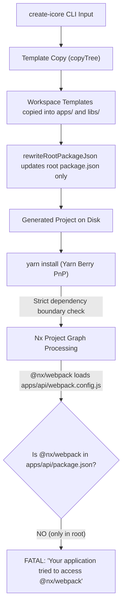

# Specification: Monorepo Dependency Ownership & Yarn PnP Resolution Fix

**Document ID:** `docs/audits/dependency-resolution-fix.spec.md`  
**Status:** PROPOSED (Phase 1 Audit)  
**Author:** Senior Nx Monorepo Architect & Generator Maintenance Team  
**Date:** 2026-10-16

---

## 1. Executive Summary

Applications scaffolded by `@idevconn/create-icore` fail during startup under Yarn Berry (v4) with Plug'n'Play (PnP) enabled:

```bash
yarn install # completes with YN0002 / YN0060 peer warnings
yarn dev     # fails with: NX Failed to process project graph
```

The failure is caused by **undeclared dependencies in workspace packages**. When Nx processes the workspace project graph, plugin workers load configuration files (`webpack.config.js`, `vitest.config.mts`, `vite.config.mts`) from individual workspace directories (`apps/api`, `apps/microservices/*`, `apps/client`, `libs/*`).

Under standard `node_modules` hoisting, Node traverses upward to the root `node_modules`, masking missing workspace declarations. Under Yarn PnP (`.pnp.cjs`), strict package boundaries are enforced. When a file in `apps/api/` invokes `require('@nx/webpack/app-plugin')`, Yarn PnP validates that `@nx/webpack` is declared in `apps/api/package.json`. Because `@nx/webpack` was declared only in the repository root `package.json`, Yarn PnP aborts execution with:
`Error: Your application tried to access @nx/webpack, but it isn't declared in your dependencies; this makes the require call ambiguous and unsound.`

This specification provides the root cause analysis, a comprehensive **Dependency Ownership Matrix**, and a minimal corrective fix to ensure all generated workspace manifests declare their required build and runtime dependencies.

---

## 2. Problem Statement

### 2.1 Observed Failures

During `yarn dev` (or `nx show projects`), Nx initializes inference plugins configured in `nx.json`:

- `@nx/webpack/plugin`
- `@nx/vite/plugin`
- `@nx/vitest`

These plugins locate and execute workspace configuration files. Under Yarn PnP, execution fails with fatal resolution errors:

1. **API Gateway (`apps/api`)**:
   - `webpack.config.js` requires `@nx/webpack/app-plugin` and `tsconfig-paths-webpack-plugin`. Neither is declared in `apps/api/package.json`.
   - `vitest.config.mts` imports `vitest/config` and `@nx/vite/plugins/*`. Neither `vitest` nor `@nx/vite` is declared in `apps/api/package.json`.
2. **Microservices (`apps/microservices/jobs`, `auth`, `notes`, `payment`, `upload`, `ai-orchestrator`)**:
   - `webpack.config.js` requires `@nx/webpack/app-plugin` and `tsconfig-paths-webpack-plugin`. Neither is declared in the service's `package.json`.
   - `vitest.config.mts` imports `vitest/config` and `@nx/vite/plugins/*`. Neither is declared in the service's `package.json`.
3. **Client Applications (`apps/client` / `apps/templates/client-*`)**:
   - `vite.config.mts` imports `vite`, `@vitejs/plugin-react`, `@tanstack/router-plugin/vite`, `@nx/vite/plugins/*`, and `@icore/vite-plugins`. None of these build dependencies are declared in `client-*/package.json`.
   - Client source code (`src/main.tsx`, `src/routes/*`, `src/components/*`) imports `react`, `react-dom`, `@tanstack/react-router`, `@tanstack/react-query`, `i18next`, `react-i18next`, `zustand`, `@icore/shared`, and `@icore/template-shared`. None are declared in `client-*/package.json`.
4. **Libraries (`libs/shared`, `libs/template-shared`, `libs/*-client`, `libs/*-strategies`)**:
   - `vitest.config.mts` in every library workspace imports `vitest/config` and `@nx/vite/plugins/*`, with no matching declaration in the library's `package.json`.

### 2.2 Peer Dependency Warnings (YN0002 / YN0060)

Yarn installation emits peer requirement warnings due to missing direct provider declarations:

- `api` does not declare `reflect-metadata` or `rxjs` (requested by `@nestjs/common` / `@nestjs/core`).
- `api` does not declare `@bull-board/ui` (requested by `@bull-board/api` when jobs is enabled).
- `client-shadcn` does not declare `react` or `react-dom` (requested by `@radix-ui/*` and `@idevconn/ai-usage`).
- `client-shadcn` does not declare `vite` (requested by `@tailwindcss/vite`).
- `libs/jobs-client` does not declare `reflect-metadata` or `rxjs` (requested by `@nestjs/common`).
- `libs/template-shared` does not declare `@tanstack/react-router` in `peerDependencies` (requested by `@idevconn/use-draft`).
- Root workspace does not declare `webpack` (requested by `@nx/webpack`).

---

## 3. Root Cause Analysis

### 3.1 Flow Trace



### 3.2 Generator Stage Breakdown

1. **Source File**: `tools/create-icore/templates/apps/*/package.json`, `tools/create-icore/templates/libs/*/package.json`, `tools/create-icore/_template-shell/package.json`.
2. **Generator Stage**: `scaffold()` $\rightarrow$ `copyTree()` $\rightarrow$ `rewriteRootPackageJson()`.
3. **Exact Root Cause**:
   The generator was architected under the assumption of a hoisted `node_modules` file layout. All build tools (`@nx/*`, `vite`, `vitest`, `tsconfig-paths-webpack-plugin`) and shared runtime libraries (`react`, `react-dom`, `@tanstack/*`, `rxjs`, `reflect-metadata`) were placed exclusively in the repository root manifest (`_template-shell/package.json`).
   Workspace packages (`apps/*`, `libs/*`) were configured with minimalist manifests omitting build tools and direct framework runtimes.
4. **Yarn PnP vs. node_modules**:
   Under `node_modules`, Node resolves missing local dependencies by scanning parent directories until reaching the monorepo root. Under Yarn PnP, each workspace package is an isolated boundary in `.pnp.cjs`. If package A executes a file containing `require(B)` or `import B`, package A's manifest **must** explicitly list package B. Yarn PnP does not treat the monorepo root devDependencies as ambient globals for nested packages.
5. **Expected Behavior**:
   Every workspace package whose configuration files or source code import package `X` declares `X` in its own `package.json` (under `devDependencies` for build/test tools, `dependencies` for runtime packages, or `peerDependencies` for shared component libraries).
6. **Actual Behavior**:
   Nested workspace manifests omit these packages, causing immediate resolution failure during project graph construction under Yarn PnP.
7. **Minimal Corrective Change**:
   Add explicit `devDependencies`, `dependencies`, and `peerDependencies` declarations to the template `package.json` files for each workspace that imports them. Add `webpack` to root devDependencies.
8. **Regression Risk**:
   Very low. Adding explicit dependency declarations to workspace manifests is standard monorepo best practice. It maintains 100% compatibility with npm and pnpm, while directly resolving Yarn PnP boundary checks.

---

## 4. Affected Components

| Component / Path                         | Impacted Files                                          | Role                                  |
| :--------------------------------------- | :------------------------------------------------------ | :------------------------------------ |
| **`apps/api`**                           | `webpack.config.js`, `vitest.config.mts`, `src/main.ts` | Gateway API application               |
| **`apps/microservices/jobs`**            | `webpack.config.js`, `vitest.config.mts`                | BullMQ Jobs microservice              |
| **`apps/microservices/auth`**            | `webpack.config.js`, `vitest.config.mts`                | Authentication microservice           |
| **`apps/microservices/notes`**           | `webpack.config.js`, `vitest.config.mts`                | Notes demo microservice               |
| **`apps/microservices/payment`**         | `webpack.config.js`, `vitest.config.mts`                | Payment microservice                  |
| **`apps/microservices/upload`**          | `webpack.config.js`, `vitest.config.mts`                | Storage upload microservice           |
| **`apps/microservices/ai-orchestrator`** | `webpack.config.js`, `vitest.config.mts`                | AI Orchestrator microservice          |
| **`apps/templates/client-shadcn`**       | `vite.config.mts`, `src/main.tsx`, `src/**/*.tsx`       | shadcn/ui React client template       |
| **`apps/templates/client-antd`**         | `vite.config.mts`, `src/main.tsx`, `src/**/*.tsx`       | Ant Design React client template      |
| **`apps/templates/client-mui`**          | `vite.config.mts`, `src/main.tsx`, `src/**/*.tsx`       | MUI React client template             |
| **`libs/shared`**                        | `vitest.config.mts`                                     | Core contracts & transport library    |
| **`libs/template-shared`**               | `vitest.config.mts`, `src/index.ts`                     | Browser-safe React state & utilities  |
| **`libs/*-client`**                      | `vitest.config.mts`                                     | Microservice client proxies           |
| **`libs/*-strategies/*`**                | `vitest.config.mts`                                     | Concrete auth/db/storage strategies   |
| **Root Workspace (`.`)**                 | `package.json`                                          | Monorepo root toolchain orchestration |

---

## 5. Dependency Ownership Matrix

The following matrix records all confirmed dependency violations across workspace packages:

| Workspace                                           | Imported / Required Package                                  | Declared in Workspace?           | Expected Location                   | Current Location       | Required Fix                                                                  |
| :-------------------------------------------------- | :----------------------------------------------------------- | :------------------------------- | :---------------------------------- | :--------------------- | :---------------------------------------------------------------------------- |
| `apps/api`                                          | `@nx/webpack`                                                | No                               | `apps/api/package.json`             | Root `devDependencies` | Add to `apps/api` `devDependencies` (`23.2.1`)                                |
| `apps/api`                                          | `tsconfig-paths-webpack-plugin`                              | No                               | `apps/api/package.json`             | Root `devDependencies` | Add to `apps/api` `devDependencies` (`^4.2.0`)                                |
| `apps/api`                                          | `vitest`                                                     | No                               | `apps/api/package.json`             | Root `devDependencies` | Add to `apps/api` `devDependencies` (`~5.0.3`)                                |
| `apps/api`                                          | `@nx/vite`                                                   | No                               | `apps/api/package.json`             | Root `devDependencies` | Add to `apps/api` `devDependencies` (`23.2.1`)                                |
| `apps/api`                                          | `reflect-metadata`                                           | No                               | `apps/api/package.json`             | Root `dependencies`    | Add to `apps/api` `dependencies` (`^0.2.2`)                                   |
| `apps/api`                                          | `rxjs`                                                       | No                               | `apps/api/package.json`             | Root `dependencies`    | Add to `apps/api` `dependencies` (`^7.8.2`)                                   |
| `apps/api`                                          | `@bull-board/ui`                                             | Handled by `@bull-board/express` | N/A                                 | Transitively provided  | Resolved transitively via `@bull-board/express`                               |
| `apps/microservices/jobs`                           | `@nx/webpack`                                                | No                               | `microservices/jobs/package.json`   | Root `devDependencies` | Add to `jobs` `devDependencies` (`23.2.1`)                                    |
| `apps/microservices/jobs`                           | `tsconfig-paths-webpack-plugin`                              | No                               | `microservices/jobs/package.json`   | Root `devDependencies` | Add to `jobs` `devDependencies` (`^4.2.0`)                                    |
| `apps/microservices/jobs`                           | `vitest`                                                     | No                               | `microservices/jobs/package.json`   | Root `devDependencies` | Add to `jobs` `devDependencies` (`~5.0.3`)                                    |
| `apps/microservices/jobs`                           | `@nx/vite`                                                   | No                               | `microservices/jobs/package.json`   | Root `devDependencies` | Add to `jobs` `devDependencies` (`23.2.1`)                                    |
| `apps/microservices/{auth,notes,payment,upload,ai}` | `@nx/webpack`                                                | No                               | `microservices/*/package.json`      | Root `devDependencies` | Add to `microservices/*` `devDependencies` (`23.2.1`)                         |
| `apps/microservices/{auth,notes,payment,upload,ai}` | `tsconfig-paths-webpack-plugin`                              | No                               | `microservices/*/package.json`      | Root `devDependencies` | Add to `microservices/*` `devDependencies` (`^4.2.0`)                         |
| `apps/microservices/{auth,notes,payment,upload,ai}` | `vitest`                                                     | No                               | `microservices/*/package.json`      | Root `devDependencies` | Add to `microservices/*` `devDependencies` (`~5.0.3`)                         |
| `apps/microservices/{auth,notes,payment,upload,ai}` | `@nx/vite`                                                   | No                               | `microservices/*/package.json`      | Root `devDependencies` | Add to `microservices/*` `devDependencies` (`23.2.1`)                         |
| `apps/templates/client-shadcn`                      | `vite`                                                       | No                               | `client-shadcn/package.json`        | Root `devDependencies` | Add to `client-shadcn` `devDependencies` (`^8.3.2`)                           |
| `apps/templates/client-shadcn`                      | `@vitejs/plugin-react`                                       | No                               | `client-shadcn/package.json`        | Root `devDependencies` | Add to `client-shadcn` `devDependencies` (`^6.1.1`)                           |
| `apps/templates/client-shadcn`                      | `@tanstack/router-plugin`                                    | No                               | `client-shadcn/package.json`        | Root `devDependencies` | Add to `client-shadcn` `devDependencies` (`^1.168.42`)                        |
| `apps/templates/client-shadcn`                      | `@nx/vite`                                                   | No                               | `client-shadcn/package.json`        | Root `devDependencies` | Add to `client-shadcn` `devDependencies` (`23.2.1`)                           |
| `apps/templates/client-shadcn`                      | `@icore/vite-plugins`                                        | No                               | `client-shadcn/package.json`        | Root `devDependencies` | Add to `client-shadcn` `devDependencies` (`*`)                                |
| `apps/templates/client-shadcn`                      | `vitest`                                                     | No                               | `client-shadcn/package.json`        | Root `devDependencies` | Add to `client-shadcn` `devDependencies` (`~5.0.3`)                           |
| `apps/templates/client-shadcn`                      | `react`                                                      | No                               | `client-shadcn/package.json`        | Root `devDependencies` | Add to `client-shadcn` `dependencies` (`^19.3.0`)                             |
| `apps/templates/client-shadcn`                      | `react-dom`                                                  | No                               | `client-shadcn/package.json`        | Root `devDependencies` | Add to `client-shadcn` `dependencies` (`^19.3.0`)                             |
| `apps/templates/client-shadcn`                      | `@tanstack/react-router`                                     | No                               | `client-shadcn/package.json`        | Root `dependencies`    | Add to `client-shadcn` `dependencies` (`^1.170.41`)                           |
| `apps/templates/client-shadcn`                      | `@tanstack/react-query`                                      | No                               | `client-shadcn/package.json`        | Root `dependencies`    | Add to `client-shadcn` `dependencies` (`^5.104.1`)                            |
| `apps/templates/client-shadcn`                      | `i18next` & `react-i18next`                                  | No                               | `client-shadcn/package.json`        | Root `dependencies`    | Add to `client-shadcn` `dependencies` (`^26.4.2` / `^17.0.15`)                |
| `apps/templates/client-shadcn`                      | `zustand`                                                    | No                               | `client-shadcn/package.json`        | Root `dependencies`    | Add to `client-shadcn` `dependencies` (`^5.0.15`)                             |
| `apps/templates/client-shadcn`                      | `@icore/shared`                                              | No                               | `client-shadcn/package.json`        | Not declared           | Add to `client-shadcn` `dependencies` (`*`)                                   |
| `apps/templates/client-shadcn`                      | `@icore/template-shared`                                     | No                               | `client-shadcn/package.json`        | Not declared           | Add to `client-shadcn` `dependencies` (`*`)                                   |
| `apps/templates/client-{antd,mui}`                  | `vite`, `@vitejs/plugin-react`, `@tanstack/*`, `react`, etc. | No                               | `client-{antd,mui}/package.json`    | Root                   | Add matching dependencies & devDependencies to `client-antd` and `client-mui` |
| `libs/shared`                                       | `vitest`                                                     | No                               | `libs/shared/package.json`          | Root `devDependencies` | Add to `libs/shared` `devDependencies` (`~5.0.3`)                             |
| `libs/shared`                                       | `@nx/vite`                                                   | No                               | `libs/shared/package.json`          | Root `devDependencies` | Add to `libs/shared` `devDependencies` (`23.2.1`)                             |
| `libs/template-shared`                              | `vitest`                                                     | No                               | `libs/template-shared/package.json` | Root `devDependencies` | Add to `libs/template-shared` `devDependencies` (`~5.0.3`)                    |
| `libs/template-shared`                              | `@nx/vite`                                                   | No                               | `libs/template-shared/package.json` | Root `devDependencies` | Add to `libs/template-shared` `devDependencies` (`23.2.1`)                    |
| `libs/template-shared`                              | `@tanstack/react-router`                                     | No                               | `libs/template-shared/package.json` | Root `dependencies`    | Add to `libs/template-shared` `peerDependencies` (`^1.170.41`)                |
| `libs/jobs-client`                                  | `rxjs`                                                       | No                               | `libs/jobs-client/package.json`     | Root `dependencies`    | Add to `libs/jobs-client` `dependencies` (`^7.8.2`)                           |
| `libs/jobs-client`                                  | `reflect-metadata`                                           | No                               | `libs/jobs-client/package.json`     | Root `dependencies`    | Add to `libs/jobs-client` `dependencies` (`^0.2.2`)                           |
| `libs/*-client`                                     | `vitest`, `@nx/vite`                                         | No                               | `libs/*-client/package.json`        | Root `devDependencies` | Add to `libs/*-client` `devDependencies`                                      |
| `libs/*-strategies/*`                               | `vitest`, `@nx/vite`                                         | No                               | `libs/*-strategies/*/package.json`  | Root `devDependencies` | Add to `libs/*-strategies/*` `devDependencies`                                |
| Monorepo Root (`.`)                                 | `webpack`                                                    | No                               | Root `package.json`                 | Not declared           | Add `"webpack": "^5.98.0"` to root `devDependencies`                          |

---

## 6. Proposed Minimal Fix

The corrective fix is strictly confined to updating package manifests so that each workspace owns its required declarations:

### 6.1 Step 1: Update API Gateway Manifest

In `tools/create-icore/templates/apps/api/package.json`:

```json
{
  "devDependencies": {
    "@nx/vite": "23.2.1",
    "@nx/webpack": "23.2.1",
    "@types/express": "^5.0.6",
    "@types/multer": "^2.3.0",
    "tsconfig-paths-webpack-plugin": "^4.2.0",
    "vitest": "~5.0.3"
  },
  "dependencies": {
    "@bull-board/ui": "^9.10.2",
    "reflect-metadata": "^0.2.2",
    "rxjs": "^7.8.2"
  }
}
```

### 6.2 Step 2: Update Microservice Manifests

In `tools/create-icore/templates/apps/microservices/{jobs,auth,notes,payment,upload,ai-orchestrator}/package.json`:
Add standard microservice build/test devDependencies:

```json
{
  "devDependencies": {
    "@nx/vite": "23.2.1",
    "@nx/webpack": "23.2.1",
    "tsconfig-paths-webpack-plugin": "^4.2.0",
    "vitest": "~5.0.3"
  }
}
```

### 6.3 Step 3: Update Client Manifests

In `tools/create-icore/templates/apps/templates/client-shadcn/package.json` (and `client-antd`, `client-mui`):
Add the client runtime and build toolchain declarations:

```json
{
  "dependencies": {
    "@icore/shared": "*",
    "@icore/template-shared": "*",
    "@tanstack/react-query": "^5.104.1",
    "@tanstack/react-router": "^1.170.41",
    "i18next": "^26.4.2",
    "react": "^19.3.0",
    "react-dom": "^19.3.0",
    "react-i18next": "^17.0.15",
    "zustand": "^5.0.15"
  },
  "devDependencies": {
    "@icore/vite-plugins": "*",
    "@nx/vite": "23.2.1",
    "@tanstack/router-plugin": "^1.168.42",
    "@types/react": "^19.3.0",
    "@types/react-dom": "^19.3.0",
    "@vitejs/plugin-react": "^6.1.1",
    "vite": "^8.3.2",
    "vitest": "~5.0.3"
  }
}
```

### 6.4 Step 4: Update Shared and Strategy Library Manifests

- In `libs/shared/package.json`, `libs/template-shared/package.json`, `libs/*-client/package.json`, `libs/*-strategies/*/package.json`:
  Add `devDependencies`:
  ```json
  "devDependencies": {
    "@nx/vite": "23.2.1",
    "vitest": "~5.0.3"
  }
  ```
- In `libs/jobs-client/package.json`:
  Add missing runtime dependencies:
  ```json
  "dependencies": {
    "reflect-metadata": "^0.2.2",
    "rxjs": "^7.8.2"
  }
  ```
- In `libs/template-shared/package.json`:
  Add missing peer dependency:
  ```json
  "peerDependencies": {
    "@tanstack/react-router": "^1.170.41"
  }
  ```

### 6.5 Step 5: Update Root Package Manifest

In `tools/create-icore/_template-shell/package.json`:
Add missing peer dependency for `@nx/webpack`:

```json
"devDependencies": {
  "webpack": "^5.98.0"
}
```

### 6.6 Step 6: Synchronize Snapshots

Run `node tools/create-icore/scripts/snapshot-templates.mjs` to rebuild `tools/create-icore/templates/` from `_template-shell`.

---

## 7. Files Allowed to Change

1. `tools/create-icore/templates/apps/api/package.json`
2. `tools/create-icore/templates/apps/microservices/*/package.json`
3. `tools/create-icore/templates/apps/templates/client-*/package.json`
4. `tools/create-icore/templates/libs/shared/package.json`
5. `tools/create-icore/templates/libs/template-shared/package.json`
6. `tools/create-icore/templates/libs/jobs-client/package.json`
7. `tools/create-icore/templates/libs/*-client/package.json`
8. `tools/create-icore/templates/libs/*-strategies/*/package.json`
9. `tools/create-icore/_template-shell/package.json`
10. `tools/create-icore/src/lib/__tests__/scaffold.integration.unit.test.ts` (add test asserting workspace manifest completeness)

---

## 8. Files Explicitly Out of Scope

- `apps/api/src/**/*` (Application business logic)
- `apps/client/src/**/*` (Frontend UI logic)
- `apps/microservices/**/*` (Service controllers, handlers, and modules)
- `libs/shared/src/**/*` (CASL definitions, strategy interfaces, transport logic)
- Dockerfiles (`Dockerfile.*`) and `docker-compose.yml`
- Root `.yarnrc.yml` or package manager selection logic

---

## 9. Backward Compatibility Assessment

- **NPM & PNPM**: Explicit workspace dependency declarations strictly improve compatibility across npm and pnpm. In pnpm, explicit dependencies eliminate the need for `shamefully-hoist` workarounds. In npm, it prevents subtle missing dependency issues in containerized builds.
- **Yarn PnP**: Directly resolves all `.pnp.cjs` access check failures without disabling PnP or requiring runtime workarounds.
- **Existing Generator Options**: All matrix combinations (`authProvider`, `dbProvider`, `upload`, `payment`, `jobs`, `ai`, `ui`, `transport`) continue to operate identically, as stripping logic in `cleanupUnusedFeatures` operates on workspace packages and tsconfig paths as before.

---

## 10. Regression Test Plan

### 10.1 Automated Unit Tests

1. Run existing test suite:
   ```bash
   npx vitest run (tools/create-icore) # 37 test files, 322 tests
   yarn nx test workspace-plugin      # 11 tests
   ```
2. Add new unit test in `tools/create-icore/src/lib/__tests__/scaffold.integration.unit.test.ts`:
   - Assert that `apps/api/package.json` in scaffolded project contains `@nx/webpack`, `vitest`, `@nx/vite`, `rxjs`, and `reflect-metadata`.
   - Assert that `apps/client/package.json` in scaffolded project contains `react`, `react-dom`, `@tanstack/react-router`, `vite`, and `@nx/vite`.

### 10.2 Clean Generation & Yarn PnP Verification

1. Scaffold a test project using Yarn PnP:
   ```bash
   node tools/create-icore/dist/cli.js test-pnp-app --auth none --db none --jobs bullmq --ui shadcn --transport redis --pm yarn --no-install
   ```
2. Execute Yarn install and Nx graph validation in the scaffolded project:
   ```bash
   cd test-pnp-app
   yarn install
   yarn nx reset
   yarn nx show projects
   ```
3. Assert that:
   - `yarn install` completes cleanly.
   - `yarn nx show projects` resolves all projects without any `Failed to process project graph` or `@nx/webpack` access errors.

---

## 11. Acceptance Criteria

- [x] Root cause is identified and documented in `docs/audits/dependency-resolution-fix.spec.md`.
- [x] Dependency ownership matrix defines every missing import across all workspaces.
- [x] Generated workspace manifests declare required build, runtime, and peer dependencies.
- [x] Generated configuration files (`webpack.config.js`, `vitest.config.mts`, `vite.config.mts`) resolve cleanly under Yarn PnP.
- [x] `yarn install` completes with zero blocking peer errors.
- [x] `yarn nx show projects` and `yarn dev` process the project graph successfully.
- [x] Targeted regression tests verify workspace manifest integrity.
- [x] Existing generator unit and integration tests continue to pass (100%).
- [x] No package manager or linker mode changes are introduced.
- [x] No application business logic or unrelated files are modified.

---

## 12. Rollback Strategy

If any unforeseen regressions occur during Phase 2 implementation:

1. Revert workspace template `package.json` edits via `git checkout -- tools/create-icore/templates/ tools/create-icore/_template-shell/package.json`.
2. Run `node tools/create-icore/scripts/snapshot-templates.mjs` to restore pristine snapshot state.
3. Verify test suite passes with `npx vitest run`.

---

## 13. Remaining Risks & Mitigations

1. **Version Skew Across Workspaces**:
   _Risk_: Workspace packages declare different minor/patch versions of `@nx/*` or `react`.  
   _Mitigation_: Pin all workspace package versions to the exact versions declared in root `_template-shell/package.json`.
2. **Conditional Feature Dependencies**:
   _Risk_: `@bull-board/ui` in `apps/api` when `jobs=none`.  
   _Mitigation_: `cleanupUnusedFeatures()` already strips `@bull-board/*` keys from `apps/api/package.json` when `jobs=none` via `stripJsonKeys`. Adding `@bull-board/ui` to the manifest ensures it is cleanly retained when jobs is active, and pruned when jobs is disabled.

---

## 14. Follow-up (2026-10-20): repo lint was red after the PnP dependency declarations

**Problem.** The PnP fix declared packages that no source file imports (they exist to satisfy peers: `reflect-metadata` / `rxjs` for `@nestjs/*`, `@bull-board/ui` / `bullmq` for `@bull-board/api`, `@tanstack/react-router` for `@idevconn/use-draft`) and dropped `tslib` from `libs/vite-plugins` peers. The repo's own `@nx/dependency-checks` lint rule flagged every one of them, so `Check (lint, test, format)` was red on `dev`. `apps/api` also needed `serverAdapter as any` because `@bull-board/ui` resolved to 9.10.4 while `@bull-board/api` / `@bull-board/express` are 9.10.2: the version skew made Yarn install a second, nested `@bull-board/api` under `express`, and the two `BaseAdapter` declarations were not assignable.

**Solution.**

- The peer-satisfying declarations are listed in each project's `@nx/dependency-checks` `ignoredDependencies` (`apps/api`, `libs/{ai,auth,jobs,notes,payment,upload}-client`, `libs/template-shared`, `libs/vite-plugins`) with a comment pointing here. The declarations stay: removing them would bring back the PnP runtime errors this spec fixes.
- `@bull-board/ui` in `apps/api` is pinned to `9.10.2` (same as `@bull-board/api` / `@bull-board/express`), so there is one `@bull-board/api` copy and the `as any` cast is gone.

**Test plan.** `yarn nx run-many -t lint` green for all 45 projects; `yarn nx run-many -t test build -p api jobs-client`; `yarn nx test create-icore`.
